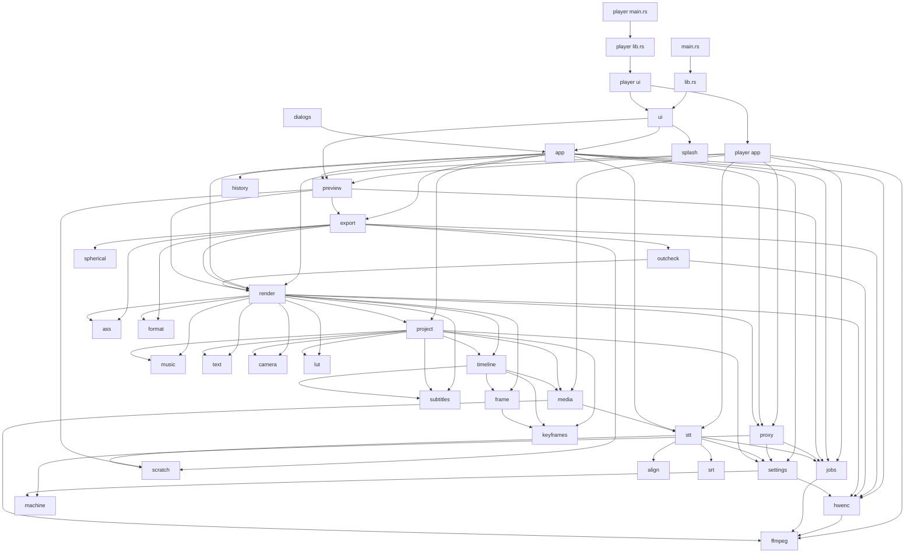
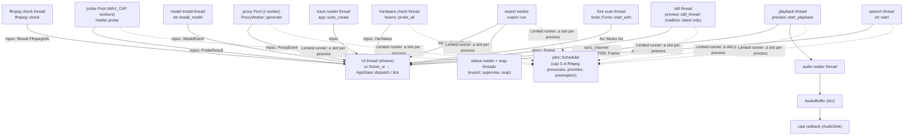
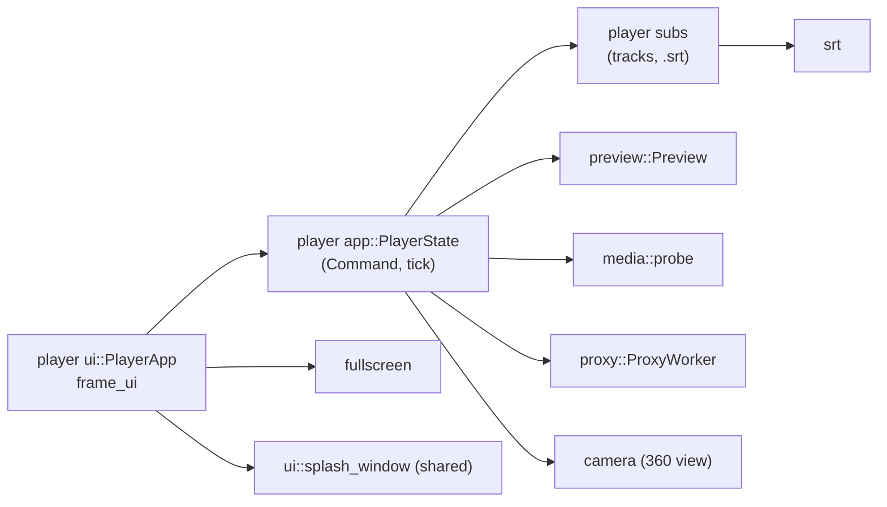

# Code — module architecture

How the modules of the editor (`src/`) and of videolore player (`player/src/`) depend on each
other and how data and threads flow between them. Every box below is a real module; the arrows
are real `use crate::…` dependencies (the main ones; the full list per module is in the table at
the end). Where to find a feature is in [code-index.md](code-index.md); what each module does is
in [code-modules.md](code-modules.md).

## Layers

| Layer | Modules |
|---|---|
| Programs | `src/main.rs` → `lib.rs` (`real_app`, `native_options`, `prepare_desktop`); `player/src/main.rs` → `player/src/lib.rs` |
| Interface | `ui` (and its sub-modules), `dialogs`, `splash`; the player's `ui`, `fullscreen` |
| Application | `app` (`AppState`, `Command`, `dispatch`, `tick`; sub-modules `command`, `effects`, `export_flow`, `frame`, `lut`, `sphere`, `subs_create`, `texts`); the player's `app`, `subs` |
| Engine (threads, processes) | `export` (+ `export::choice`), `outcheck`, `hwenc`, `preview`, `proxy`, `stt`, `jobs`, `ffmpeg`, `scratch` |
| Rendering (pure) | `render` (filter graphs and argv), `format`, `ass`, `camera`, `frame`, `keyframes`, `lut`, `spherical` |
| Model (pure) | `project` (+ `project::v9`), `timeline`, `music`, `subtitles`, `text`, `selection`, `history`, `media`, `srt`, `align` |
| Configuration and notices | `settings` (uses `hwenc`, `machine`, `project`), `fonts` (uses `text`), `notices` (uses `ffmpeg`, `packaging`) |
| Base (no dependency on other modules) | `time`, `machine`, `packaging`, `desktop`, `history`, `splash` |

The layers group the modules by role; they are **not** a strict layering: some lower modules use
upper ones, and the model and engine modules form cycles (next section).

## Module dependency graph

### Cycles

The modules depend on each other in cycles. These pairs use each other directly:

| Pair | Why |
|---|---|
| `project` ↔ `settings` | `settings` reads and writes its file with `project::read_limited` / `write_atomic`; `project` uses `settings::read_capped` |
| `stt` ↔ `media` | `stt` uses `MediaId` and `media::display_name`; `media` uses `stt::language_name` |
| `stt` ↔ `scratch` | `stt` makes its work folders and private files with `scratch`; `scratch` uses `stt::builtin_models` to know which partial speech files it may clean |
| `scratch` ↔ `proxy` | `scratch` uses `proxy::is_cache_file`; `proxy` makes its work folders with `scratch` |
| `lut` ↔ `project` | `lut` reads `.cube` files with `project::read_limited`; `project` checks LUT paths with `lut::path_ok` / `display_name` when loading |
| `subtitles` ↔ `timeline` | subtitle lines are mapped onto the timeline's clips; the timeline uses `subtitles::Pos` and `POS_MAX` for positions |
| `subtitles` ↔ `text`, `text` ↔ `ass` | lines use `text::Anchor360`, texts use `subtitles::Pos` and sizes; texts use `ass::outline`, the ASS writer uses `text::font_px` and `AssEvent` |

Through these pairs, 16 modules form one strongly connected group: `align`, `ass`, `camera`,
`frame`, `lut`, `media`, `music`, `project`, `proxy`, `scratch`, `settings`, `srt`, `stt`,
`subtitles`, `text`, `timeline`. This is legal Rust inside one crate and costs nothing at run
time; it only makes the modules harder to separate. There is no cycle around the export:
`export` runs `outcheck`, which reuses only `render` and `hwenc`; `jobs::Limited` wraps any
`ffmpeg::Runner`, and `ffmpeg` does not know about the scheduler.

## Import → timeline → preview → export

The same project value feeds the preview and the export: `render` builds both command lines
from it (one graph builder, `render::build_graph` / `compose_frame`), so what is seen is what is
exported. Project files go through `project::save` (atomic) and `project::load` (capped,
validated; `project::v9` turns a file of format 8 or older into format 9 in memory).

## Threads and channels

- Nothing slow runs on the UI thread: `AppState::tick` drains every channel once per frame.
- Cancellation is an `Arc<AtomicBool>` per job; `Limited::cancellable` kills the job's processes.
- A job of an old project is dropped by replacing its channel (New/Open); late results go nowhere.
- Every child process is started by a `ffmpeg::Runner` (`SystemRunner` in the programs, fakes
  in the tests) with an argument list, never a shell.

## videolore player

The player builds its own `Project` of one clip in memory (never saved) and reuses the editor's
engine; it is compiled without the `stt` feature, so it has no speech engine and no network code
(checked in CI with `cargo tree`).

## Dependencies of each module

`grep -oE "crate::[a-z_0-9]+"` over the code of each module, comments and tests excluded:

| Module | Uses |
|---|---|
| `align` | media, srt, subtitles, time |
| `app` | desktop, export, ffmpeg, fonts, format, frame, history, hwenc, jobs, machine, media, music, outcheck, preview, project, proxy, render, scratch, selection, settings, stt, subtitles, text, time, timeline |
| `ass` | subtitles, text, time |
| `camera` | media, text, time |
| `dialogs` | app, project |
| `export` | ass, ffmpeg, format, hwenc, media, outcheck, project, render, scratch, spherical, time |
| `ffmpeg` | time |
| `fonts` | text |
| `format` | media, time |
| `frame` | keyframes, subtitles, time |
| `hwenc` | ffmpeg |
| `jobs` | ffmpeg |
| `keyframes` | time |
| `lut` | media, project |
| `media` | ffmpeg, stt, time |
| `music` | media, time, timeline |
| `notices` | ffmpeg, packaging |
| `outcheck` | ffmpeg, hwenc, render, time |
| `preview` | export, ffmpeg, jobs, project, render, scratch, time |
| `project` | camera, keyframes, lut, media, music, settings, subtitles, text, time, timeline |
| `proxy` | ffmpeg, jobs, machine, media, scratch, settings, time |
| `render` | ass, camera, ffmpeg, format, frame, hwenc, lut, media, music, project, proxy, subtitles, text, time, timeline |
| `scratch` | project, proxy, stt |
| `selection` | subtitles, text |
| `settings` | hwenc, machine, project |
| `spherical` | scratch |
| `srt` | subtitles, time |
| `stt` | align, ffmpeg, jobs, media, project, scratch, settings, srt, subtitles, time |
| `subtitles` | media, text, time, timeline |
| `text` | ass, subtitles, time |
| `timeline` | frame, keyframes, media, subtitles, time |
| `ui` | app, ass, camera, desktop, export, ffmpeg, format, frame, hwenc, keyframes, lut, media, music, notices, preview, project, selection, settings, splash, stt, subtitles, text, time, timeline |
| `desktop`, `history`, `machine`, `packaging`, `splash`, `time` | none |
| player | camera, desktop, ffmpeg, jobs, machine, media, notices, preview, project, proxy, render, scratch, settings, splash, srt, stt, subtitles, time, ui |
