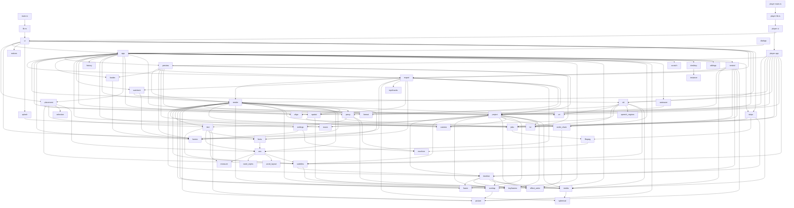
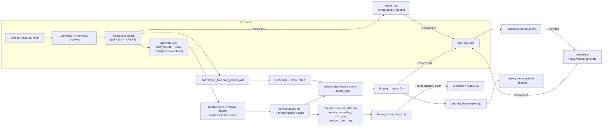
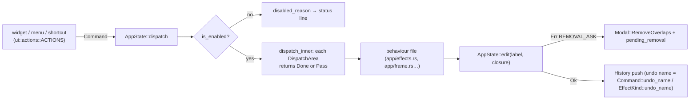
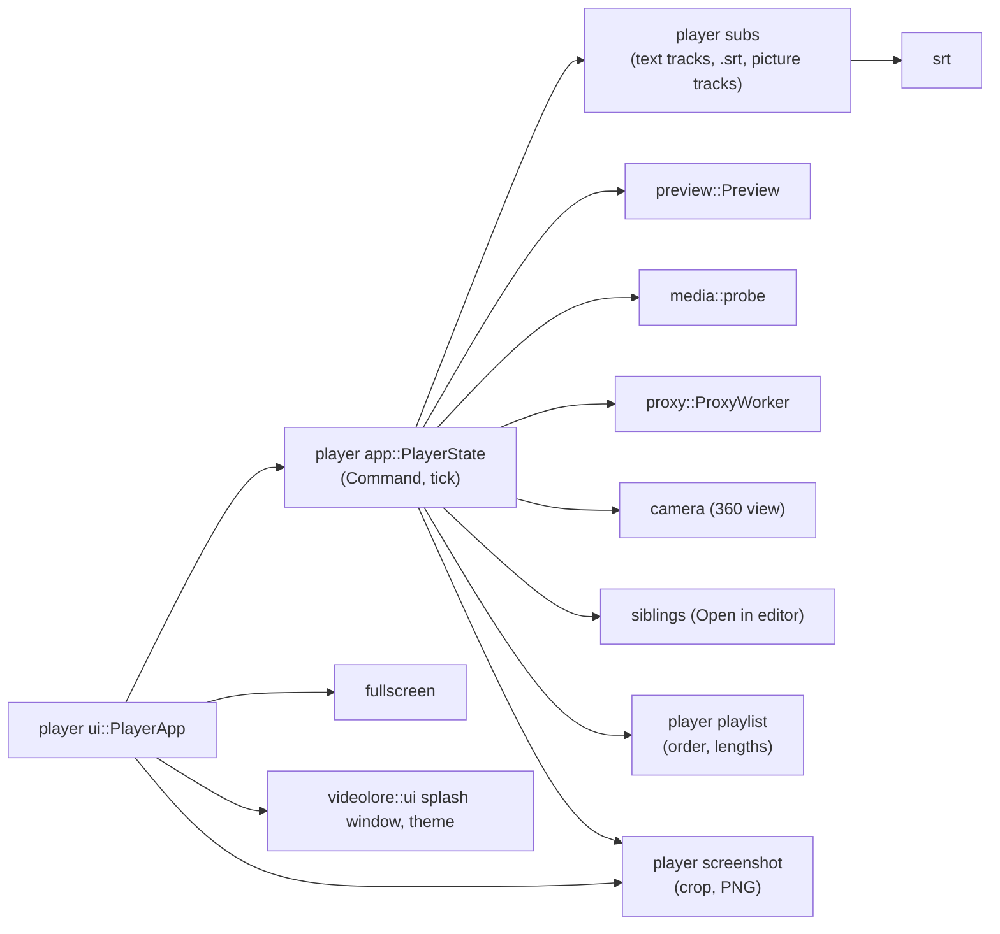
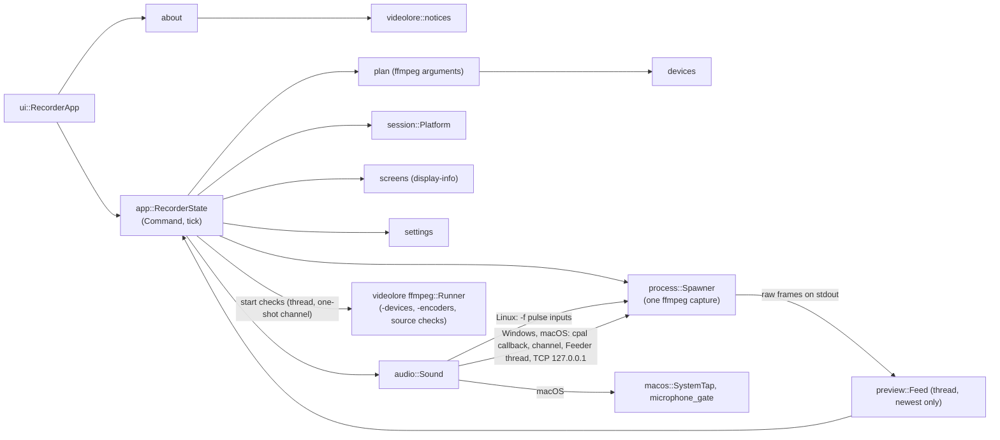

# Code — module architecture

Back to the [index](code.md). How the modules of the editor (`src/`), of videolore player (`player/src/`) and of the screen recorder (`screen-spy/src/`) depend on each other and how data and threads flow between them. Every box is a real module; the arrows are real `use crate::…` dependencies (checked with `scripts/module-deps.sh`, which prints the full list, the users of a module with `-r`, or the whole graph with `--mermaid`). Where a feature is: [code-index.md](code-index.md); the patterns: [code-modules.md](code-modules.md).

## Layers
| Layer | Modules |
|---|---|
| Programs | `src/main.rs` → `lib.rs` (`real_app`, `native_options`, `prepare_desktop`); `player/src/main.rs` → `player/src/lib.rs` |
| Interface | `ui` (sub-modules per area: `actions`, `menu`, `toolbar`, `keymap`, `effects`, `popups`, `frame_popups`, `text_popup`, `lut_popup`, `applied_effects`, `timeline`, `overlap_lane`, `overlap_box`, `picture`, `boxes`, `placement`, `layout`, `place`, `theme`, `strings`, `splash_window`…), `dialogs`; the player's `ui`, `fullscreen` |
| Application | `app`: `AppState`, `Command` (`command`), the effect table (`effect_kind`), the dispatcher and its areas (`dispatch_project`, `dispatch_subtitles`, `dispatch_settings`, `dispatch_interface`, `dispatch_playback`, `dispatch_view`, `dispatch_effects`, `dispatch_objects`), `enabled`, `tick`, and the behaviour files (`effects`, `frame`, `lut`, `overlap`, `applied`, `texts`, `placing`, `sphere`, `stops`, `subs_create`, `subs_import`, `export_flow`, `recovery`); the player's `app`, `subs` |
| Engine (threads, processes) | `export` (+ `choice`), `outcheck`, `hwenc`, `hwdec`, `preview`, `proxy`, `stt`, `jobs`, `ffmpeg`, `scratch`, `autosave`, `instance` (one window), `desktop`, `siblings` |
| Rendering (pure) | `render` (`segments`, `inputs`, `graph`, `plan`, `args`, `overlay`, `steps`), `spatial`, `format`, `ass`, `word_styles`, `word_layout`, `camera`, `frame`, `keyframes`, `lut` (`parse`, `store`), `spherical`, `mp4tracks`, `picture` |
| Model (pure) | `project` (+ `v9`, `v13`, `order`), `timeline`, `overlap`, `effect_order`, `order_chain`, `music`, `subtitles`, `text` (+ `timing`, `layout`, `events`), `selection`, `history`, `media`, `srt`, `align`, `speech_regions`, `measure`, `placement` |
| Configuration and notices | `settings` (+ `interface`), `fonts`, `notices`, `packaging`, `splash`, `machine` |
| Shared helpers | `base` (`io`, `private`, `pos`, `names`, `language`, `shadow`, `font`, `testing`): uses no other module, so it is in no cycle; `time` |

The top-level modules form **no cycle** (since 2.0.1; the shared helpers moved to `base`). `tests/module_cycles.rs` parses `src/` with `syn` and fails on a cycle, on a `crate::` path in `base` and on `#[path]`; a new module is found without a list. Each item has one path: re-exports are only the `render`, `text` and `app` hubs over their private files.

## Module dependency graph
The main edges (leaves `base`, `time` and the uses of `ffmpeg` by every process starter are left out for readability):

## Import → timeline → preview → export

The same project value feeds the preview and the export: `render` builds both command lines from it (one graph builder: `render::build_graph`, `compose_frame`, the overlay stage and the step builder), so what is seen is what is exported. Project files go through `project::save` (atomic) and `project::load` (capped, validated; `project::v9` and `project::v13` convert older formats in memory; the writer makes format 16). `autosave` writes a clone of an unsaved project to the cache every two minutes.

## A command, from the click to the undo step

## Threads and channels

```mermaid
flowchart TD
  UI["UI thread (eframe)<br/>ui::frame_ui → AppState::dispatch / tick"]
  CHK["ffmpeg check thread<br/>ffmpeg::check"] -->|"mpsc: Result FfmpegInfo"| UI
  HWP["hardware check thread<br/>hwenc::probe_all, then hwdec::probe_all"] -->|"mpsc: HwStatus, hwdec::Working"| UI
  INB["inbox files<br/>instance::poll_current (every 250 ms in tick)"] -->|"project path"| UI
  PRB["probe Pool<br/>media::probe"] -->|"mpsc: ProbeResult"| UI
  PRX["proxy Pool (1 worker)<br/>ProxyWorker::generate"] -->|"mpsc: ProxyEvent"| UI
  EXP["export worker<br/>export::run (+ spatial pre-pass, output check threads)"] -->|"mpsc: ExportEvent"| UI
  STL["still thread<br/>preview::still_thread (latest request only; kept background)"] -->|"mpsc: Frame"| UI
  PLY["playback thread<br/>preview::start_playback"] -->|"sync_channel: Frame"| UI
  PLY --> AUD["audio reader thread"] --> BUF["AudioBuffer (Arc)"] --> SINK["cpal callback (AudioSink)"]
  STT["speech thread<br/>stt::start"] -->|"mpsc: SttEvent"| UI
  MOD["model install thread<br/>stt::install_model"] -->|"mpsc: ModelEvent"| UI
  TRK["track reader thread<br/>app::subs_create"] -->|"mpsc"| UI
  LUT["LUT load and preparation threads<br/>lut::Load, lut::Prep"] -->|"mpsc: percent, table"| UI
  FNT["font scan thread<br/>fonts::Fonts::start_with"] -->|"Arc Mutex list"| UI
  AUT["autosave worker<br/>autosave::start"] -->|"mpsc: Result"| UI
  IMP["import thread, one at a time<br/>nested::start (+ its export worker)"] -->|"mpsc: nested::Event"| UI
  STR["snapshot thread, one at a time<br/>strips::Strips::tick"] -->|"mpsc: Thumb"| UI
  SCH["jobs::Scheduler<br/>(cap 3–6 ffmpeg processes, priorities, preemption)"]
  PRB & PRX & EXP & STL & PLY & STT & HWP & IMP & STR -.->|"Limited runner: a slot per process"| SCH
```

- Nothing slow runs on the UI thread: `AppState::tick` drains every channel once per frame.
- Cancellation is an `Arc<AtomicBool>` per job (dropping a `Load` or `Prep` stops it); `Limited::cancellable` kills the job's processes.
- A job of an old project is dropped by replacing its channel (New/Open); late results go nowhere.
- Every child process is started by a `ffmpeg::Runner` (`SystemRunner` in the programs, fakes in the tests) with an argument list, never a shell.

## videolore player

The player builds its own `Project` of one clip in memory (never saved) and reuses the editor's engine; it is built without the `stt` feature, so it has no speech engine and no network code (checked in CI with `cargo tree`).

## videolore screen spy

Threads: the UI thread; one thread per start for the checks (it calls `Sound::open`); per capture one preview reader and one stderr reader; on Windows and macOS one thread that owns the cpal streams (`audio::hold`), the system's audio thread and a feeder thread per source. The UI thread never waits for the checks or the capture: `tick` polls them, and Stop has a 15 s deadline.
