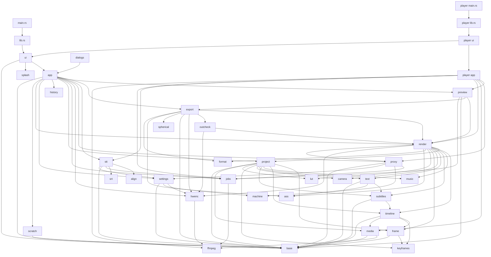
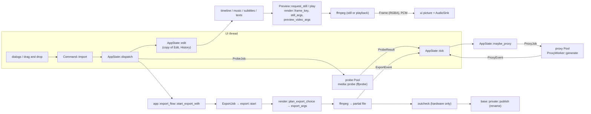
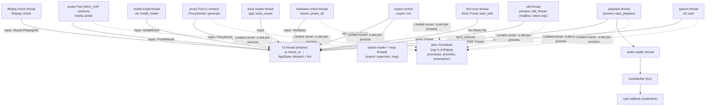
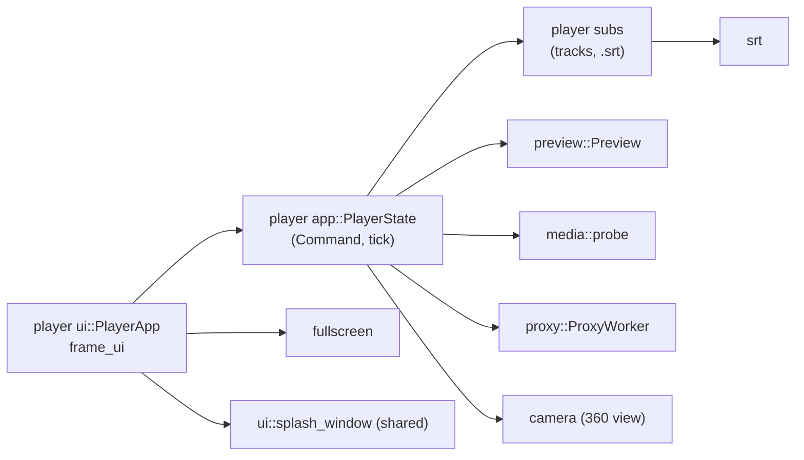

# Code — module architecture

How the modules of the editor (`src/`) and of videolore player (`player/src/`) depend on each
other and how data and threads flow between them. Every box below is a real module; the arrows
are real `use crate::…` dependencies (the main ones; the full list per module is in the table at
the end). Where to find a feature is in [code-index.md](code-index.md); what each module does is
in [code-modules.md](code-modules.md).

## Layers

| Layer | Modules |
|---|---|
| Programs | `src/main.rs` → `lib.rs` (`real_app`, `native_options`, `prepare_desktop`); `player/src/main.rs` → `player/src/lib.rs` |
| Interface | `ui` (and its sub-modules), `dialogs`, `splash`; the player's `ui`, `fullscreen` |
| Application | `app` (`AppState`, `Command`, `dispatch`, `tick`; sub-modules `command`, `effects`, `export_flow`, `frame`, `lut`, `sphere`, `subs_create`, `texts`); the player's `app`, `subs` |
| Engine (threads, processes) | `export` (+ `export::choice`), `outcheck`, `hwenc`, `preview`, `proxy`, `stt`, `jobs`, `ffmpeg`, `scratch` (work-folder root and start-up cleanup) |
| Rendering (pure) | `render` (filter graphs and argv), `format`, `ass`, `camera`, `frame`, `keyframes`, `lut`, `spherical` |
| Model (pure) | `project` (+ `project::v9`), `timeline`, `music`, `subtitles`, `text`, `selection`, `history`, `media`, `srt`, `align` |
| Configuration and notices | `settings` (uses `base`, `hwenc`, `machine`), `fonts` (uses `text`), `notices` (uses `ffmpeg`, `packaging`) |
| Shared helpers: `base` | `base::io` (capped reading, atomic writing), `base::private` (private folders and files, `Work`), `base::pos` (`Pos`, `POS_MAX`, `Anchor360`, `align_h`, `align_v`), `base::names` (cache, partial and speech-model file names), `base::language` (language table). It uses no module of videolore, so it is in no cycle |
| Leaves (no dependency on other modules) | `time`, `machine`, `packaging`, `desktop`, `history`, `splash` |

The layers group the modules by role. `base` is the bottom: every module may use it, and it uses none. Since 2.0.1 the modules form no cycle (next section).

## Module dependency graph

### Cycles

Since 2.0.1 the top-level modules form **no cycle**. Before, nine pairs used each other
(`project`/`settings`, `stt`/`media`, `stt`/`scratch`, `scratch`/`proxy`, `lut`/`project`,
`subtitles`/`timeline`, `subtitles`/`text`, `ass`/`text` and `app`/`ui`), and 16 modules formed
one strongly connected group. The cycles were removed by moving the shared helpers into the
`base` module, which uses no other module of videolore:

| Pair (2.0.0) | Now |
|---|---|
| `project` ↔ `settings` | both use `base::io` (`read_limited`, `read_capped`, `write_atomic`); `project::write_atomic` is a wrapper that maps the error |
| `stt` ↔ `media` | `base::language` (`language_name`, `iso639_2_to_1`) |
| `stt` ↔ `scratch` | `base::private` (`Work`, `private_dir`, `create_private_file`, `publish`), `base::names` (`SPEECH_MODEL_FILES`, `is_partial_name`) |
| `scratch` ↔ `proxy` | `base::names::is_cache_file`, `base::private` |
| `lut` ↔ `project` | `lut` reads with `base::io::read_limited` |
| `subtitles` ↔ `timeline` | `base::pos::{Pos, POS_MAX}` |
| `subtitles` ↔ `text` | `base::pos::Anchor360` |
| `ass` ↔ `text` | `AssEvent`, `font_px` and `BASE_HEIGHT` live in `ass`; `text` uses `ass` |
| `app` ↔ `ui` | `app::sphere` uses `base::pos::{align_h, align_v}` (was `ui::boxes`); `ui` uses `app`, never the reverse |

Nothing is re-exported from the old modules: each item has one path. `export` runs `outcheck`,
which reuses only `render` and `hwenc`; `jobs::Limited` wraps any `ffmpeg::Runner`, and `ffmpeg`
does not know about the scheduler. `tests/module_cycles.rs` reads every file of `src/` with
`syn` (comments, `#[cfg(test)]` items and test files skipped) and fails `cargo test` on a cycle
between top-level modules, on any `crate::` path inside `base`, and on a `#[path]` attribute.
A new module is found without a list. Not seen by it: paths built inside macros.

## Import → timeline → preview → export

The same project value feeds the preview and the export: `render` builds both command lines
from it (one graph builder, `render::build_graph` / `compose_frame`), so what is seen is what is
exported. Project files go through `project::save` (atomic) and `project::load` (capped,
validated; `project::v9` turns a file of format 8 or older into format 9 in memory).

## Threads and channels

- Nothing slow runs on the UI thread: `AppState::tick` drains every channel once per frame.
- Cancellation is an `Arc<AtomicBool>` per job; `Limited::cancellable` kills the job's processes.
- A job of an old project is dropped by replacing its channel (New/Open); late results go nowhere.
- Every child process is started by a `ffmpeg::Runner` (`SystemRunner` in the programs, fakes
  in the tests) with an argument list, never a shell.

## videolore player

The player builds its own `Project` of one clip in memory (never saved) and reuses the editor's
engine; it is compiled without the `stt` feature, so it has no speech engine and no network code
(checked in CI with `cargo tree`).

## Dependencies of each module

`grep -oE "crate::[a-z_0-9]+"` over the code of each module, comments and tests excluded (`base` uses none; modules with no entry use none):

| Module | Uses |
|---|---|
| `align` | media, srt, subtitles, time |
| `app` | base, camera, desktop, export, ffmpeg, fonts, format, frame, history, hwenc, jobs, keyframes, lut, machine, media, music, outcheck, preview, project, proxy, render, scratch, selection, settings, srt, stt, subtitles, text, time, timeline |
| `ass` | base, subtitles, time |
| `camera` | base, media, time |
| `dialogs` | app, project |
| `export` | ass, base, ffmpeg, format, hwenc, media, outcheck, project, render, spherical, time |
| `ffmpeg` | time |
| `fonts` | text |
| `format` | media, time |
| `frame` | base, keyframes, time |
| `hwenc` | ffmpeg |
| `jobs` | ffmpeg |
| `keyframes` | time |
| `lut` | base, media |
| `media` | base, ffmpeg, time |
| `music` | media, time, timeline |
| `notices` | ffmpeg, packaging |
| `outcheck` | ffmpeg, hwenc, render, time |
| `preview` | base, export, ffmpeg, jobs, project, render, time |
| `project` | base, camera, frame, keyframes, lut, media, music, subtitles, text, time, timeline |
| `proxy` | base, ffmpeg, jobs, machine, media, settings, time |
| `render` | ass, base, camera, ffmpeg, format, frame, hwenc, lut, media, music, project, proxy, subtitles, text, time, timeline |
| `scratch` | base |
| `selection` | subtitles, text |
| `settings` | base, hwenc, machine |
| `spherical` | base |
| `srt` | subtitles, time |
| `stt` | align, base, ffmpeg, jobs, media, settings, srt, subtitles, time |
| `subtitles` | base, media, time, timeline |
| `text` | ass, base, subtitles, time |
| `timeline` | base, frame, keyframes, media, time |
| `ui` | app, ass, base, camera, export, ffmpeg, format, frame, hwenc, keyframes, lut, media, music, notices, project, selection, settings, splash, stt, subtitles, text, time, timeline |
